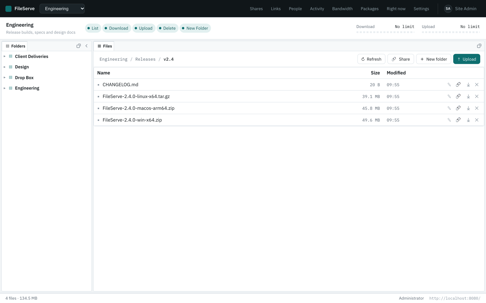
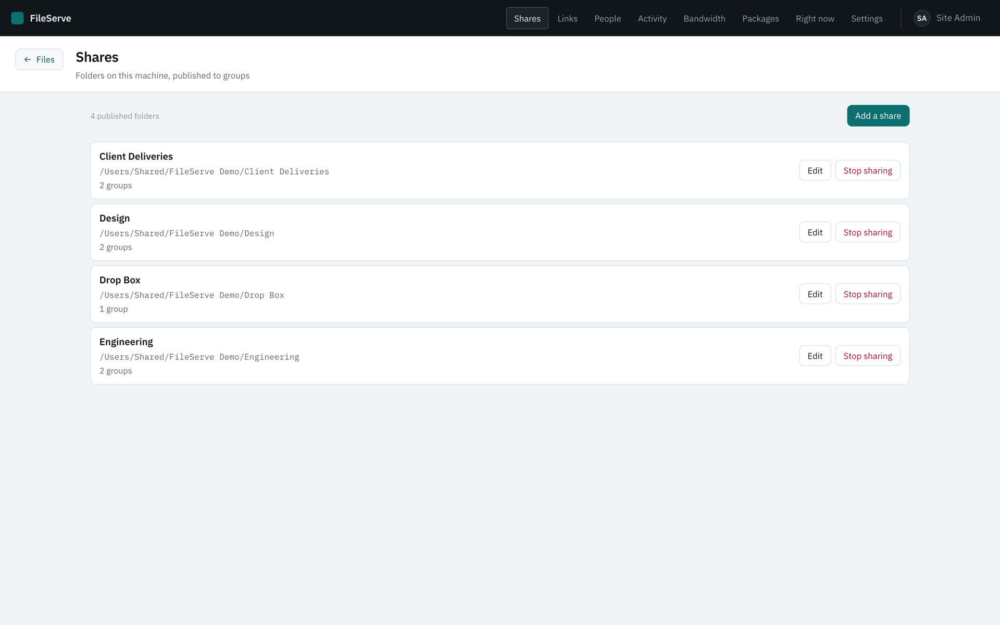
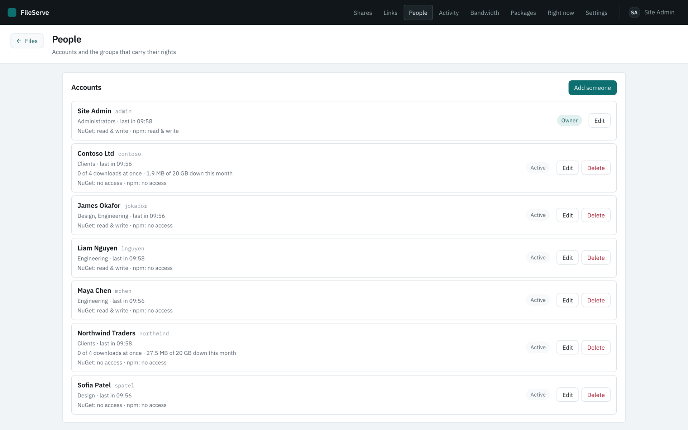
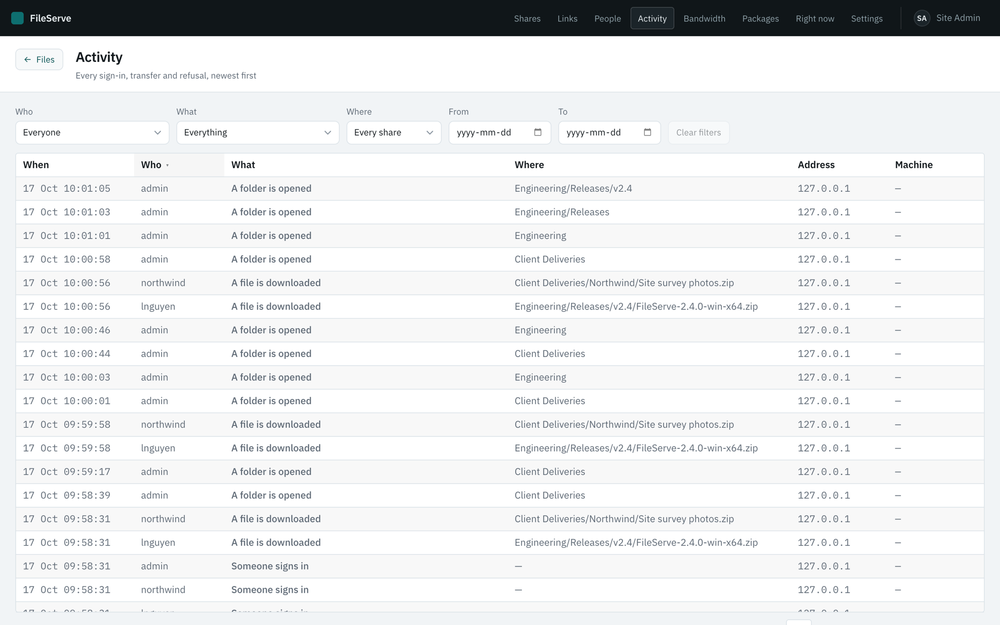
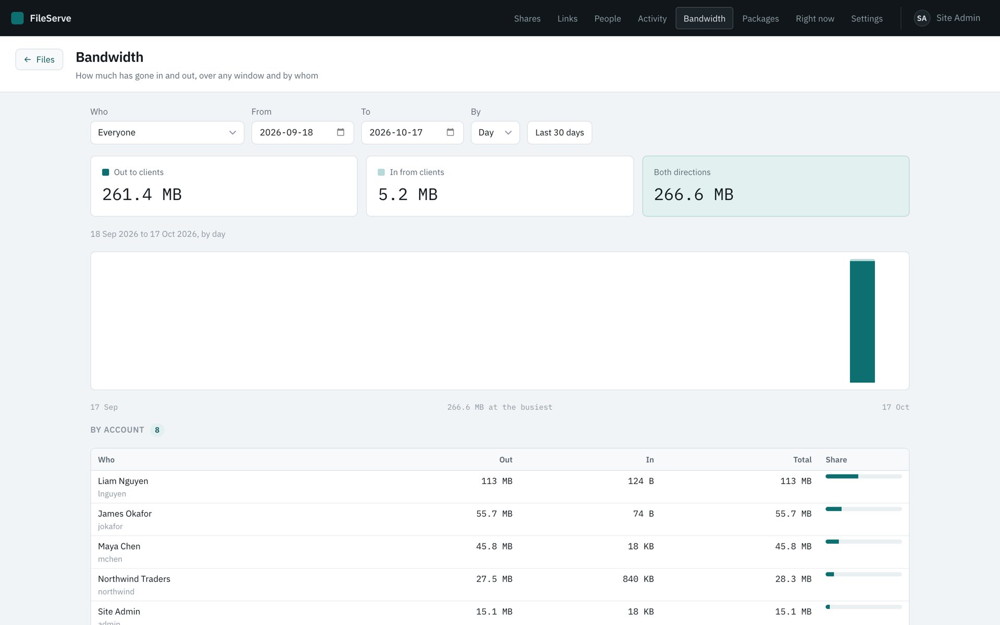
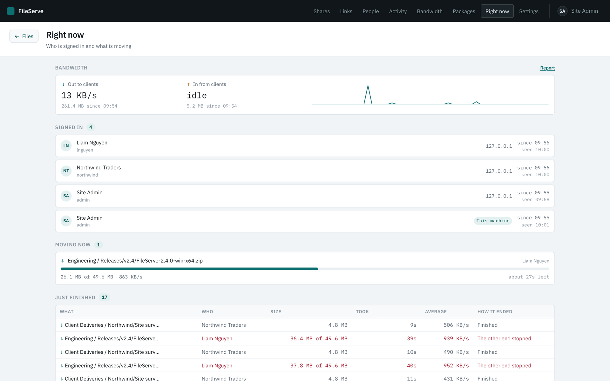
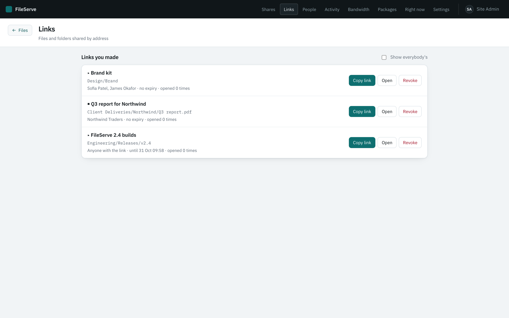
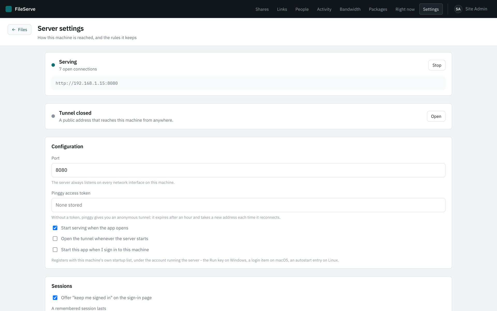
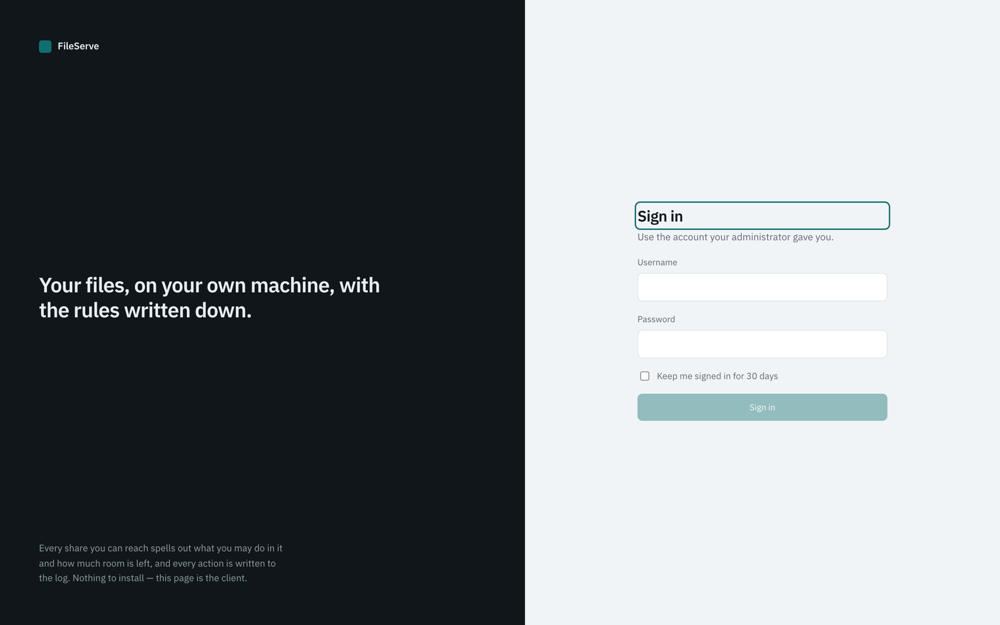

# ShinyFileServe

A self-hosted file server for a team. It runs as a desktop app on **macOS (AppKit)**, **Linux
(GTK4)** and **Windows**, keeps to the system tray, and serves a browser UI so nobody has to
install a client. Folders are published to groups with explicit permissions and metered quotas,
and every action is written to an audit log. The same server can also host a private **NuGet feed**
and **npm registry**, authenticated with personal access tokens and governed by the same groups.

The desktop app has **no screens of its own** — it is a window onto its own server, and everything
an operator does happens in the portal. Building the same forms twice would have meant two of
everything to keep in step and one of them quietly falling behind.

> **ShinyFileServe is not open source.** The code is published so you can read it, learn from it and
> build it for yourself, but you may not copy, repackage, rebrand or redistribute it. See
> [License](#license). The Shiny libraries it's built on *are* open source (MIT).

## Download

Every build is on the [Releases](https://github.com/ShinySoftware/ShinyFileServe/releases) page.
These are the only official builds. If you got FileServe from anywhere else, it isn't ours.

| Platform | Download | Notes |
| --- | --- | --- |
| macOS (Apple silicon) | `FileServe-<version>-macos-arm64.zip` | Signed and notarized. Unzip and move to Applications. |
| Windows (x64, Arm64) | `FileServe-<version>-windows-<arch>-setup.exe` | Installs for the current user, no administrator needed. Not yet code-signed, so SmartScreen warns about an unknown publisher: **More info → Run anyway**. Allow it through Windows Firewall on first launch, or nobody else can reach it. |
| Debian, Ubuntu (x64, arm64) | `FileServe-<version>-linux-<arch>.deb` | `sudo apt install ./FileServe-*.deb` pulls in GTK and WebKitGTK. Needs WebKitGTK 6 - Ubuntu 24.04, Debian 12 or newer. |
| Fedora, RHEL (x64, arm64) | `FileServe-<version>-linux-<arch>.rpm` | `sudo dnf install ./FileServe-*.rpm` |

`SHA256SUMS.txt` beside them covers every file. The app checks for a newer release when it starts,
and on macOS and Windows installs it itself; on Linux, install the new package the same way.

<picture>
  <source media="(prefers-color-scheme: dark)" srcset="docs/screenshots/browse-dark.png">
  
</picture>

```
┌─────────────────────────────────────────────────────────────────────┐
│  Desktop app (.NET MAUI)          tray icon · console window        │
│  ├── Shiny.Net.HttpServer  ───────  HTTP on every interface, :8080  │
│  │     ├── .NuGet / .Npm   ───────  /nuget feed, /npm registry      │
│  │     ├── AppDeviceBridge ───────  frontend host: embedded zip or  │
│  │     │                            a signed update, served by it   │
│  ├── Shiny.DocumentDb      ───────  one SQLite file: users, roles,  │
│  │                                  shares, grants, quotas, log,    │
│  │                                  bandwidth history               │
│  ├── AppDeviceBridge.Tunnel ──────  optional public https (pinggy)  │
│  ├── Shiny.Notifications   ───────  desktop notification per event  │
│  └── Shiny.Core            ───────  start at login, per platform    │
└─────────────────────────────────────────────────────────────────────┘
```

## Screenshots

| | |
| --- | --- |
| <br>**Shares** — folders on this machine, published to groups | <br>**People** — accounts, groups, parallel-transfer caps and quotas |
| <br>**Activity** — every sign-in, transfer and refusal | <br>**Bandwidth** — in and out over any window, by account |
| <br>**Right now** — who is signed in and what is moving | <br>**Links** — files and folders shared by address |
| <br>**Settings** — serving, the tunnel and start at login | <br>**Sign in** — what anyone not on this machine sees first |

## Projects

| Project | TFM | What it is |
| --- | --- | --- |
| `src/ShinyFileServe.Shared` | `net10.0` | DTOs that cross the wire |
| `src/ShinyFileServe.Core` | `net10.0` | Documents and domain services on Shiny.DocumentDb + SQLite |
| `src/ShinyFileServe.Server` | `net10.0` | Shiny.Net.HttpServer endpoints, cookie auth, the NuGet feed and npm registry; the SPA host and tunnel from Shiny.AppDeviceBridge |
| `src/ShinyFileServe.Web` | `net10.0` | Blazor WebAssembly frontend (Shiny.Blazor.Controls) |
| `src/ShinyFileServe.App` | `net10.0` | The MAUI shell: a WebView, the tray icon, server control |
| `heads/ShinyFileServe.MacOS` | `net10.0-macos` | AppKit head — `dotnet/maui-labs` |
| `heads/ShinyFileServe.Linux` | `net10.0` | GTK4 head — `dotnet/maui-labs` |
| `heads/ShinyFileServe.Windows` | `net10.0-windows10.0.19041.0` | WinUI head |

`ShinyFileServe.App` targets plain `net10.0` on purpose: there is no official `-linux` TFM, so the
GTK4 head is itself a `net10.0` project and the shared UI has to be something it can reference.

## Libraries

Versions are pinned centrally in `Directory.Packages.props`.

| Package | Used for |
| --- | --- |
| `Shiny.Net.HttpServer` | The HTTP server, routing, middleware, cookie auth |
| `Shiny.Net.HttpServer.NuGet` | The NuGet v3 feed at `/nuget` |
| `Shiny.Net.HttpServer.Npm` | The npm registry at `/npm` |
| `Shiny.AppDeviceBridge` (+ `.WebView`, `.Tunnel`) | Serving and updating the embedded frontend; the public tunnel |
| `Shiny.DocumentDb` + `Shiny.DocumentDb.Sqlite` | The document store over one SQLite file |
| `Shiny.Blazor.Controls` | Portal UI — `DataGrid`, password strength meter and the rest |
| `Shiny.Maui.Controls` (+ `.Desktop`) | Desktop shell controls |
| `Shiny.Notifications` (+ `.Linux`) | Desktop notifications per activity |
| `Shiny.Core` | Start at login (`IAppStartupInstaller`) |
| `nClam` | Talking to a ClamAV daemon |
| `Microsoft.Maui.Platforms.MacOS` / `.Linux.Gtk4` | The AppKit and GTK4 heads, from `dotnet/maui-labs` |

## Building and running

```bash
dotnet build ShinyFileServe.slnx          # everything buildable on this machine

dotnet run --project heads/ShinyFileServe.MacOS     # macOS, AppKit
dotnet run --project heads/ShinyFileServe.Linux     # Linux, GTK4
dotnet run --project heads/ShinyFileServe.Windows   # Windows, WinUI
```

Add `-p:SkipFrontendBuild=true` for inner-loop work on the desktop UI — it skips publishing and
zipping the Blazor app, which is the slow part of a build.

Nothing is seeded on first run. The administrator is created by the first person to open the app,
**and only from the machine running it** — otherwise whoever found the address on the network first
would own the server. An account with a password the whole internet knows is worse than no account
at all, so nothing is seeded either.

### Linux prerequisites

```bash
sudo apt install libgtk-4-dev libwebkitgtk-6.0-dev gobject-introspection \
                 libgirepository1.0-dev gir1.2-gtk-4.0 gir1.2-webkit-6.0 pkg-config
sudo apt install libayatana-appindicator3-1 libgtk-3-0    # tray icon
dotnet workload install maui-tizen    # the MAUI build targets - the only MAUI workload the SDK offers on Linux
```

GNOME 40+ needs the AppIndicator shell extension for the tray icon; KDE works as shipped.

## Signing in

Three ways in, in the order they are decided:

1. **From the machine running the server**, no password. The desktop app opens straight into the
   portal. The trust rests on two facts about the connection, checked every request: it came from
   a loopback address, and it did **not** arrive through a tunnel. pinggy forwards into loopback,
   so the address alone would hand the internet an administrator the moment a tunnel opened. No
   header is involved by design — a header is something a client can claim.
2. **A session cookie**, from a normal sign-in.
3. **Nothing**, which is a 401 and the sign-in page.

The first administrator and the `Administrators` group it belongs to are both **protected**: they
can be renamed and re-passworded, and they cannot be deleted, disabled, or stripped of admin. Every
other account can be enabled, disabled or deleted freely.

## How the frontend gets served

`ShinyFileServe.Web` is published, zipped, and embedded into `ShinyFileServe.Server.dll` as
`ShinyFileServe.Server.wwwroot.zip`. [Shiny.AppDeviceBridge](https://github.com/shinyorg/appdevicebridge)'s web app
host serves it straight out of the resource, precompressed assets included, so a head ships one assembly and serves
the whole SPA. It is registered on the server's own builder after the app's middleware, so bandwidth metering,
authentication and the password gate run first, exactly as they did for `UseBlazorWebAssembly`.

- **Everyone gets the pages.** `ServeWebAppRemotely` and `ServeWebAppLocally` are both on: the portal shell is public
  and shows a sign-in form until `/api/auth/me` answers. The APIs behind it are authorized as before.
- **Caching.** `FrontendCachePolicy` is the host's `OnPrepareResponse`: fingerprinted `_framework` files are
  immutable for a year, and everything else revalidates.
- **Updates without an app release.** Set `FileServeServerOptions.FrontendUpdateServer` and `FrontendPublicKey`, and
  the host checks a Shiny.AppDeviceBridge.AspNetCore release server whenever the server starts. It installs a newer
  signed frontend into `webapp/` beside the database. The embedded build stays the floor, and nothing is checked while
  these are unset.
- **Bridges are closed.** No page calls device bridges, so the built-in settings and files bridges are off, and the
  bridge policy stays "this device only", in debug builds too.
 See the targets at the bottom of `ShinyFileServe.Server.csproj`; they hook
`AssignTargetPaths`, not `BeforeCompile`, because resource manifest names are assigned before
`BeforeCompile` runs and an `EmbeddedResource` added there is silently dropped.

## Permissions

Rights are granted to a **group**, never to a person. A user in two groups gets the union of both,
and the most generous quota of the two — adding someone to a group can never take access away.

| Permission | Without it |
| --- | --- |
| List | The share is invisible; the API answers 404, not 403 |
| Download | Files can be seen but not read |
| Upload | No new files, no overwrites |
| Delete | Files stay |
| New Folder | No sub-directories |

A group can be marked **Administrator**, which grants every share regardless of grant, the activity
log, and the settings — from the console window or the browser. `User.IsAdmin` pins the same power
to one account.

## Quotas

Two ceilings, on the two things a quota can sensibly be about.

**Per group, per share** — the quota on a folder grant. Download and upload separately: a byte cap
over a **day, week, month, or in total**, plus an optional cap on any single upload. Someone in two
groups gets the more generous of the two, so being added to a group never takes allowance away.

**Per account, across every share** — the quota on the person, set beside their transfer limits on
the People screen. Same windows, same two directions, and it is the one allowance a group cannot
widen: a grant answers how much this group may move out of this share, and this answers how much
this person may move off this server at all.

Both are checked, and a transfer meets whichever runs out first. They are counted separately —
a byte that goes through a metered share is charged to the share's period and to the account's,
because the two ceilings are independent and either may be the one that stops the next request.
Weeks are ISO-8601 so a weekly quota does not roll over on a different day depending on the
machine's culture.

A download charges the whole file the moment it is authorised, even for a range request — charging
per range would let a client fetch a file in pieces for free. An upload that turns out to exceed
the quota is deleted rather than left on disk. Either refusal is a **429**, and the activity log
says which of the two ceilings it was.

## Virus scanning

Uploads are scanned once they are whole and **before they are published**. The bytes are written to
a temporary file beside the target, the scan looks at that, and only a file nobody objected to is
moved into place — so an infected upload is never a path anyone could list or download, not even for
the moment it would take to delete it again. A refusal is `422`, is written to the activity log as a
denial, and reaches the person uploading as the signature that matched.

There is no antivirus engine written in .NET, so nothing is shipped in the app: each head asks
something that is already on the machine.

| Head | Engine | Installed by |
| --- | --- | --- |
| Windows | AMSI — Defender, or whatever replaced it | Already there |
| macOS, Linux, Windows | ClamAV (`clamd`) | The operator |

**Windows** needs nothing. `AmsiFileScanner` hands the buffer to whichever antimalware provider is
registered, which on a stock machine is Defender, with its signatures already current because
Windows keeps them that way.

**Everywhere else** it is a ClamAV daemon the operator runs, and it is off until they say otherwise:

```bash
brew install clamav          # macOS         (then freshclam, then clamd)
sudo apt install clamav-daemon clamav-freshclam   # Debian/Ubuntu

FILESERVE_CLAMD=1 dotnet run --project heads/ShinyFileServe.MacOS
```

| Variable | What it does |
| --- | --- |
| `FILESERVE_CLAMD` | `1` for a clamd at `127.0.0.1:3310`, or `host:port` for one elsewhere |
| `FILESERVE_CLAMD_PATHSCAN` | Let clamd open the file itself instead of streaming it — faster, and past the stream size cap, but only if clamd can read the share |
| `FILESERVE_SCAN_STRICT` | Refuse anything that could not be scanned, rather than letting it through |

An environment variable rather than a setting in the portal on purpose: which engine can be reached
is a fact about the machine the server runs on, and an administrator on the other side of the
network cannot see whether the daemon they just pointed at exists.

Two limits are worth knowing. Files over **25MB are not scanned** by default, because clamd's own
`StreamMaxLength` is 25MB and AMSI wants the whole file in one buffer; raising
`FileScanOptions.MaxScanBytes` means raising clamd's limit to match, or scanning by path, which has
no limit. And with no engine reachable an upload is **allowed** — a file server whose uploads stop
because a daemon died is its own kind of outage, and `FILESERVE_SCAN_STRICT` is there for operators
who would rather have the outage.

Only ClamAV's socket protocol is spoken, never its library: `clamd` is GPL and stays a separate
process on the other side of a socket, and [nClam](https://github.com/tekmaven/nClam), which is
Apache-2.0, is all that is linked in.

## Passwords

Configurable, and switchable off entirely — a cupboard server on a home network does not need a
policy, and friction with nothing behind it is just friction. Minimum length, and optional
requirements for a capital, a lower-case letter, a number, a symbol, and not being one of the
commonly guessed passwords.

The browser shows Shiny's strength meter with the server's own rules loaded into it, so somebody
sees where they stand as they type. **The server validates the same rules on every path that sets a
password** — the meter is the affordance, not the gate. Existing passwords are never re-checked;
the rules apply the next time one is set.

## Sessions

- **Keep me signed in** can be turned off entirely; when on, the window is configurable in days.
- **Idle sign-out** after N minutes with no keyboard or mouse. Enforced in the browser, which is
  the only place that can see a screen go idle; the server's part is that a non-remembered session
  is a browser session and an expired account's cookie is rejected on its next request.

## Accounts

An account **expires** rather than being switched off: a date, or nothing at all, which means it
lives forever. Past the date it cannot sign in and its existing cookie is refused on the next
request. The first administrator cannot be put on a timer — a server that times out its only
administrator has locked everybody out of itself.

An account may instead be **anonymous**: no password, and anybody who reaches the server can sign
in as it from a button on the sign-in page. Its groups still decide everything it can do. It can
never be an administrator — refused when set directly, refused through a group, and refused again
when the claim is built, so a database that arrived with the flag already set still grants nothing.
Password sign-in against one is refused, and it is never remembered on a browser.

Either kind can carry a **limit on how many transfers it runs at once** — downloads and uploads
counted separately, whatever share the files come from. A request past the limit is refused with a
429 while the earlier ones are still going, and a slot comes back the moment a transfer ends,
however it ended. It sits beside the byte quotas rather than replacing them: one is about how much
an account may move in total, the other about how much of the server it may occupy at once.

## Passwords over time

- A password can be given a **maximum age**. Past it somebody still signs in, but the API answers
  **428** to everything except reading their own account and replacing the password — an expired
  password that only the browser knew about would be a suggestion, not a rule.
- Anyone can change **their own** password from Profile, producing the current one to do it. That
  check is metered by the same counter as a sign-in, so a session left open on somebody else's
  screen is not an unlimited oracle on the password it was too polite to ask for.
- An account **locks itself** after a run of failed sign-ins, and only an administrator can let it
  back in. A wrong password against a locked account reads exactly like a wrong password against
  any other — saying "locked" to somebody who has not proved they know the password would turn the
  message into a way to find out which accounts exist. The right password on a locked account does
  say so, because by then they have proved it.
- The machine running the server signs in over loopback without a password, so an administrator
  locked out over the network can always recover from the app's own window.

## Right now

Who is signed in, and what is moving. Live transfers carry the share, the path, the direction,
bytes so far against the total, the speed over a five-second window and the time left; finished
ones carry how long they took, the average speed, and whether they finished, failed, or the other
end walked away. The counting happens in the stream itself, so it is what actually moved rather
than what was asked for, and the per-chunk cost is one interlocked add.

The browser asks once a second while the screen is open. It is polled rather than streamed: a
WebAssembly client cannot consume server-sent events without an EventSource bridged through JS
interop, and the whole payload is a few hundred bytes.

## Bandwidth

Two questions, two screens, because they are asked at different moments.

**Right now** leads with the rate: bytes a second out to clients and in from them, the totals since
the app started, and a minute of history drawn behind them so a number can be read as busy or
typical rather than just large.

**Bandwidth** is the report — a window, a shape and a culprit. Filter it by date range and by
account, cut it by day or by hour, and it answers with the totals both ways, a bar per period, and
a table of who moved what. Periods with nothing in them are still drawn, so a quiet weekend reads as
a quiet weekend instead of closing up the week.

Both count the **bodies that actually crossed the socket**, wrapped as they are written and read
rather than added up from `Content-Length`: a declared length is what was promised, and the
interesting cases are the ones where the promise was not kept. Everything is counted, not only
files — the browser fetching the application, a page of JSON per click, a 401 on the way to the
sign-in page — because a figure that left those out would never match what the operator is measuring
the link with. Traffic with nobody signed in behind it is real bandwidth with no account to put it
against, so it lands on one **Not signed in** row rather than being dropped.

Counts reach the database in batches: one row per account per hour, which is what makes it cheap
enough to meter every request rather than only the interesting ones, and small enough to keep for
two years by default (`FileServeOptions.BandwidthRetention`) where the log is kept for one. A report
flushes whatever has not been written yet before it answers, so it is never ten seconds behind
itself.

This is separate from **Right now**'s transfer list, which is about files: a transfer has a path, a
percentage and a client that may walk away, and bandwidth is just the bytes.

## Screens, not modals

Anything somebody **reads** — Activity, People, Shares, Right now, Settings — is a page with an
address, and so is the **share editor** (`/shares/new`, `/shares/{id}`): choosing the folder means
walking a tree, and a tree inside a dialog grows the dialog with every branch until its buttons are
below the bottom of the window. Anything somebody **finishes** — the account editor, Profile, a
confirmation — is a modal. A log with filters, sorting and paging inside a dialog is a dialog being
used as a window.

The share editor puts where it points on the left and one block per group on the right, because
rights are granted to a group and never to a person. A group's five rights sit on a grid whose
columns hold their width across every group, so the eye can run down one right through all of them;
a quota's window and its amount share a label and a line, because they are one answer.

Activity is Shiny's `DataGrid` driven by its `ServerData` delegate, so the sort and the page it
shows are the ones the store applied — the columns that offer to sort are exactly the ones the
query can order by, and Where and Machine, which it cannot, do not offer.

The desktop shell has no address bar and no back button, so every page carries its own way back to
the files.

## Choosing a folder to share

The path used to be typed into the share editor, which meant reading it off the server machine and
carrying it across by hand — and a typo produced a share pointing at nothing. Administrators now
walk the server's own folders over the API and pick one.

The picker opens on the places somebody actually means — home, Desktop, Documents, Downloads, the
machine root, and mounted volumes (drives on Windows) — with everything else one branch away.
Hidden folders are left out until asked for. A folder another share already publishes is marked, so
the same folder is not published twice by accident. A folder that does not exist yet cannot be
picked from a list, so the picker can make one where it stands.

Only directory names are ever read or reported — never a file, never a file's contents. It is
administrator-only, and no wider than what an administrator already had: the editor has always
accepted any path on the machine, and this only shows what is there to type.

## Names and notes

An administrator can give any file or folder inside a share a friendly name and a note. The name on
disk stays visible beside the alias — a renamed file nobody can find by its real name is worse than
one with an awkward name.

## Share links

A file or a folder can be handed out as an address. The 🔗 beside an entry in the file list makes a
link to it, and **Share** in the toolbar makes one to the folder on screen. Each link is for one of two
audiences:

- **Anyone with the link**: no account and no sign-in. The address is 128 random bits, and that is
  the whole of its protection, so treat it like a key.
- **Particular accounts**: picked from a list. Somebody without a session is sent to sign in and
  brought straight back; anybody signed in as somebody else is told the link was for other people.

A link can also stop working after a day, a week, 30 or 90 days. A folder opens as a **gallery**:
photos and videos as tiles, a full-screen viewer with the arrow keys, and everything else as a plain
list with a download button. HEIC goes in the list rather than the gallery, because only Safari can
draw it.

- **Anybody who may download something may share it.** A link carries no rights of its own. It lends
  its creator's, re-checked on every request, so taking away their grant or their account closes
  every link they made on the next click. It is narrowed to reading whatever the creator could do.
- **Downloads count against the creator's quotas**, folder and account both. Otherwise an "anyone"
  link would be a way round every quota on the server.
- **An anonymous account cannot make links.** Anybody can be one, so its links would be nobody's.
- The address uses the **public tunnel when it is open, otherwise the LAN address**, worked out
  when the link is read rather than stored. A link copied from the desktop window is therefore never
  `127.0.0.1`, and one made before the tunnel opened picks up the tunnel's address afterwards.
- **Copy** works over plain http too. The clipboard API exists only on https and loopback, so it
  falls back to the older copy command there.
- **Links** in the top bar lists what you made (copy again, open, revoke) and what was shared with you.
  An administrator can switch it to everybody's links. Making, revoking and opening a link all go in
  the activity log, under the visitor's name when they signed in and as "link from …" when they did
  not.
- Each photo in a gallery is a download in its own right, so it is charged and logged as one. An
  album viewed once is the album's size against the creator's quota.

### Anonymous access without a link

For a folder that should simply be open, with no address to pass around, use an **anonymous account**
instead: create an account with *Anyone can sign in as this account*, put it in a group of its own,
and grant that group List and Download on the folder. The sign-in page then offers *Continue as …*
to everybody who reaches the server, and what they see is exactly what that group was granted.

## The tray

The tray icon is the app's front door; the window is one view onto it.

- The address people need — the **public tunnel when it is open, otherwise the LAN address**.
  Clicking it opens the browser there and leaves it on the clipboard.
- Start/stop the server, open/close the tunnel.
- Open FileServe, and the only Quit in the application.

The icon is a thin folder outline that follows the menu bar's tint while nobody is connected, and
turns green while somebody is. "Connected" means a signed-in person who has made a request in the
last five minutes, from anywhere but this machine — counting the app's own window would leave it
permanently lit and say nothing.

Closing the window puts the app away rather than shutting the server down, and the app leaves the
Dock/taskbar the first time its window is closed rather than at launch — an app that vanished
before anyone had seen it would be hard to get back.

The icon is the same folder mark as the app icon, so the two read as one application.

**The status item has to be created straight after `builder.Build()`, before any window exists.**
Created later — from `App.CreateWindow`, dispatched, or delayed — the `NSStatusItem` is constructed
without error and never appears in the menu bar. Each head calls `StartFileServe()` on the built
`MauiApp` for exactly this reason. On macOS, Quit also goes to `NSApplication.Terminate` rather
than `Application.Quit()`: the head turns off terminate-after-last-window so the server outlives
the window, which means MAUI's Quit would only put the window away.

## Starting at login

A switch on the Settings screen registers the app with whatever this machine uses to start things
when its user signs in. It is `IAppStartupInstaller` from **Shiny.Core**, asked for once
in `ConfigureFileServe` and answered per head by the asset NuGet picked for that head's TFM — so
there is no per-head implementation here to write, and none to keep in step:

| Head | What is written |
| --- | --- |
| Windows (`net10.0-windows`) | A value under `HKCU\Software\Microsoft\Windows\CurrentVersion\Run`, which Task Manager lists under Startup |
| macOS (`net10.0-macos`) | An `SMAppService.MainApp` login item |
| Linux (plain `net10.0`) | An XDG autostart entry at `$XDG_CONFIG_HOME/autostart/net.shinylib.fileserve.desktop` |

Per-user everywhere, never machine-wide: this server hands out one person's files under one person's
account, and a machine-wide entry would start it for everybody who signs in to the box — including
people the operator never meant to run it as.

The identifier is set explicitly to `net.shinylib.fileserve` rather than left to be inferred. It
becomes the `Run` value name and the `.desktop` file name, so it has to survive an upgrade, and MAUI
Essentials' `AppInfo` is not answerable on the GTK4 head to be inferred from anyway.

**There is no copy of this in the settings document.** The registry value or the file on disk *is*
the setting: a person can delete it from Task Manager, from GNOME Tweaks, or with `rm`, and a
remembered flag would then be a second answer that disagrees with the machine and wins the argument
it should lose. Every read asks the platform — `/status` is fetched when the settings screen opens
rather than polled, so it costs nothing worth counting.

Writing is the same principle in reverse: the switch reports what the machine actually did, not what
it was asked to do. `AppStartupState` is mirrored across the wire as `RunAtStartupState`, member
for member, the same way `TunnelStatus` mirrors the tunnel's own enum — because "off" is not one
answer but four, and each is a different thing for the operator to do about it:

| State | What it means |
| --- | --- |
| `Enabled` | The machine will start the app at the next sign-in |
| `NotRegistered` | Supported, and switched off |
| `RequiresApproval` | Registered, and macOS is waiting for the person to allow it in System Settings › General › Login Items |
| `DisabledByUser` | Registered, then switched off from outside this app — Task Manager, an autostart editor |
| `DisabledByPolicy` | Blocked by a policy this app cannot overrule |
| `NotSupported` | No such concept here, or the app cannot work out where it is installed |

`RunAtStartupText.Explain` lives in the shared contract rather than at either end of it: the browser
needs a sentence for the hint under the switch and the server needs one for the message when a
change did not take, and the two must not drift into telling different stories. A registration that
comes back as anything but `Enabled` puts the checkbox back where the machine says it is and raises
the explanation as a warning, rather than leaving a saved setting that was never true.

> [!NOTE]
> macOS registers a login item through `SMAppService`, which wants the running app to be a proper
> bundle. A build an operator made themselves and left outside `/Applications` may come back as
> `RequiresApproval` — or refuse — where the same code in a shipped, notarised bundle does not.

> [!NOTE]
> The app still opens its console window when it is launched this way. Starting minimised to the
> tray is a separate change — MAUI creates a window at launch on every head, and this codebase
> deliberately has no programmatic `Hide` (see **Two things the macOS backend does not do for you**).

## Package feeds

The server can host a **NuGet feed** at `/nuget` and an **npm registry** at `/npm`, served by
`Shiny.Net.HttpServer.NuGet` and `Shiny.Net.HttpServer.Npm`. Both are off until an administrator
switches them on in Settings, and a feed that is off answers 404 exactly like a route that was never
mapped. Both are always mapped, so switching one on takes effect on the next request — no restart.

```bash
dotnet nuget add source http://server:8080/nuget/v3/index.json -n fileserve -u me -p sfs_…
dotnet nuget push My.Package.1.0.0.nupkg -s fileserve -k sfs_…

npm config set registry http://server:8080/npm/
npm login --auth-type=legacy        # your FileServe password in, a token out
npm publish
```

Neither library authenticates anybody. `PackageGateMiddleware` runs in front of both, turns a token
into an account and an account into package permissions, and lets through only what those allow.
**The portal's cookie and the loopback sign-in count for nothing here** — a package client never has
either, and letting a browser session or a local process inherit the machine owner's rights would
make "who pushed this" unanswerable.

| Permission | Feed | Allows |
| --- | --- | --- |
| Restore | NuGet | Restore and search |
| Push | NuGet | `dotnet nuget push` a new version |
| Unlist | NuGet | `dotnet nuget delete` — unlist (or delete, per settings) and relist |
| Install | npm | Install and search |
| Publish | npm | Publish, deprecate, dist-tag and manage owners of packages you maintain |

Like folder rights, these are granted to a **group** and folded across every group a person is in.
An account can then override each feed on its own — *From groups*, *No access*, *Read*, or *Read &
write* — in either direction, so one person can be held to reads in a group that publishes. An
administrator holds everything; an anonymous account holds nothing.

Requests with **no token** get the anonymous set from Settings, which is **reads only** — the save
path strips anything else, because a package nobody can be held to account for is how a supply chain
gets poisoned. npm has no separate unpublish permission (npm removes a version with the same request
that deprecates one), so unpublishing is a server setting instead.

| Setting | Default |
| --- | --- |
| NuGet / npm enabled | Off |
| Anonymous reads | None |
| `dotnet nuget delete` deletes permanently | Off — it unlists, as nuget.org does |
| npm allows unpublish | On |
| Fall through to registry.npmjs.org for anything not published here | Off |

Packages live as plain folder layouts under `packages/nuget` and `packages/npm` beside the database,
so they can be copied, seeded or backed up by hand.

### Access tokens

Anyone can create **personal access tokens** from Profile — a name and an optional expiry — and
revoke their own. The secret (`sfs_…`) is shown once; only its SHA-256 hash is stored, with the last
four characters kept as a hint. The prefix makes a leaked token recognisable to a secret scanner.
`npm login --auth-type=legacy` mints one from the account's password, through the same sign-in as the
portal, so a wrong password counts toward the lockout.

The account behind a token is checked on **every request**: expiring, locking, deleting or making an
account anonymous stops its tokens immediately rather than when they run out. Anonymous accounts
cannot hold tokens at all. A token is accepted from wherever a client puts one — `X-NuGet-ApiKey`,
the password half of Basic (`nuget.config` credentials, npm's `_auth`), or Bearer (npm's
`_authToken`).

### Package traffic

The **Packages** screen lists every feed request — who, which token, which package and version, the
operation (metadata, search, download, publish, remove, account), status, bytes and duration —
filterable by account, token, feed, operation, package, date and refusals only. It also lists every
token on the server, and an administrator can revoke any of them from there. A rejected token is
logged as such rather than as nobody.

Rows are buffered and written in batches every five seconds — a restore is dozens of requests a
second — and kept for 90 days by default (`FileServeOptions.PackageTrafficRetention`). Pushes,
publishes, unlists and unpublishes also go to the activity log.

## Notifications

Desktop notifications for whichever activities you pick — sign-ins, refusals, transfers, deletions,
package publishes and removals.
`Shiny.Notifications` registers per head (`AddNotifications()` only exists on the platform builds);
where no manager is registered the tray icon's own balloon is used instead.

## Backup and restore

The whole database in one file — accounts, groups, shares, quota counters, bandwidth history,
settings, access tokens and the activity log. Not the files themselves, and not the packages in the NuGet
feed or npm registry; those stay on disk where they are, and a share whose folder has since moved simply
points nowhere until an administrator repoints it.

**Download a backup** streams a consistent copy taken through SQLite's online backup API, so it can
be taken while the server is serving. **Choose a backup to restore** uploads a candidate and reads
it before anything is touched: the account and administrator counts, share and log-entry counts and
the size come back for confirmation, and a file with no administrator in it is refused rather than
restored into a server nobody can sign into.

Confirming stops the server, writes the backup *into* the live database rather than over the file —
the document store holds a long-lived connection, and a file swap would leave it reading a replaced
inode — and starts the server again; the browser polls and reloads itself when it answers. The
database it replaced is kept beside it as `db.sqlite.previous`.

Restoring replaces every account, so a backup that does not contain your own account signs you out.
The confirmation says so.

## API

Everything under `/api`. JSON is source-generated end to end — there is no reflection path on
either side, so a type missing from a `JsonSerializerContext` is a build warning rather than a
runtime surprise on a trimmed head.

| Route | Who |
| --- | --- |
| `POST /api/auth/login`, `POST /api/auth/logout`, `GET /api/auth/me` | anyone |
| `GET /api/auth/policy` | anonymous — the sign-in page needs it before anyone signs in |
| `GET /api/folders`, `GET /api/folders/{id}` | signed in |
| `GET /api/files`, `/download`, `POST /upload`, `/directory`, `DELETE /api/files` | signed in, per permission |
| `POST /api/auth/setup` | anonymous, only from loopback, and only until the first account exists |
| `GET /api/activity` (filter by user, action and date window) | administrators |
| `GET /api/admin/status`, `PUT /api/admin/settings`, `/server/{start,stop}`, `/tunnel/{start,stop}` | administrators |
| `GET /api/admin/user-details`, `POST /api/admin/users`, `DELETE /api/admin/users/{id}` | administrators |
| `GET /api/admin/roles`, `POST /api/admin/roles`, `DELETE /api/admin/roles/{id}` | administrators |
| `GET /api/admin/shares`, `/{id}`, `POST`, `DELETE /{id}` | administrators |
| `PUT /api/admin/annotation` | administrators |
| `GET /api/admin/browse` (the machine's folders), `POST /browse/directory` | administrators |
| `GET /api/account/profile`, `POST /api/account/password` | anyone signed in, about themselves only |
| `POST /api/auth/anonymous` | anyone — and only for an account marked anonymous |
| `GET /api/admin/live` (sessions, transfers and the current rate), `POST /api/admin/users/{id}/unlock` | administrators |
| `GET /api/admin/bandwidth` (filter by user and date window, by day or hour) | administrators |
| `GET /api/admin/backup`, `POST /stage`, `POST /restore`, `DELETE /stage` | administrators |
| `GET /api/account/tokens`, `POST /api/account/tokens`, `DELETE /api/account/tokens/{id}` | anyone signed in, their own tokens only |
| `GET /api/admin/packages/tokens`, `DELETE /tokens/{id}`, `GET /traffic` | administrators |
| `/nuget/…`, `/npm/…` | per access token and package permission — see **Package feeds** |

Password rules travel on `GET /api/auth/policy` so the setup and account screens can render the
meter before anyone has signed in.

## Building a release

```bash
dotnet publish heads/ShinyFileServe.MacOS -c Release -f net10.0-macos -p:CreatePackage=false
```

Produces an Apple-silicon `FileServe.app` under `bin/Release/net10.0-macos/osx-arm64/`, ad-hoc
signed. The head sets `RuntimeIdentifier` to `osx-arm64` so every publish agrees — a universal build
would AOT every assembly twice for an Intel build nobody runs. Publish without `-o`, which splits the
bundle. Drop `-p:CreatePackage=false` to get a `.pkg` installer instead.

To ship a release, push a tag like `v1.2.0` (or run the **Release** workflow and give it a version).
`.github/workflows/release.yml` publishes the app signed with Developer ID and the hardened runtime,
notarizes and staples it, and attaches `FileServe-<version>-macos-arm64.zip` to a GitHub release. A
tag with a suffix (`v1.2.0-beta1`) becomes a pre-release. Local Release builds stay ad-hoc signed
unless you pass `-p:CodesignKey="Developer ID Application: …"`.

Release builds run the IL trimmer, so **test the published app rather than only the Debug one** —
nothing here depends on runtime reflection (JSON is source-generated end to end, DocumentDb runs
with `UseReflectionFallback = false`), but that is a property worth re-checking rather than
assuming.

## Two things the macOS backend does not do for you

Both are handled in `heads/ShinyFileServe.MacOS`, and both fail silently rather than loudly:

- **`MauiIcon` produces `AppIcon.icns` but nothing writes `CFBundleIconFile`.** Without that key
  macOS shows the generic application icon in the Dock, the app switcher and Finder. The head's
  own `Info.plist` supplies it.
- **`WindowHandler.OnWindowClosed` reads `VirtualView` unguarded** in the shipped preview (fixed
  upstream on `main`), so a close arriving after the handler is disconnected aborts the process.
  Nothing here closes a window programmatically for that reason — the close button and the tray are
  the only paths, and both are safe.

## Where data lives

One SQLite file plus a cookie-signing key — and a `packages` folder once a feed has been used — under
the platform's application-data directory
(`~/Library/Application Support/ShinyFileServe` on macOS, `~/.config/ShinyFileServe` on Linux,
`%AppData%\ShinyFileServe` on Windows). Settings live in that database rather than beside it,
because the browser edits the same values and a second copy on disk would be a second source of
truth.

Set `FILESERVE_DATA` to run against a different directory: a demo, a second instance, a test. It has
to be an environment variable, because on macOS the default comes from the OS rather than from
`HOME`, so nothing else moves it. The screenshots above were taken that way, against a throwaway
database.

## Security notes

- The server binds **every interface**. On a LAN that is the point; through the tunnel it is the
  public internet, so give people real passwords before opening one.
- **Host names are checked.** A request must name the server by an IP address, loopback, this machine's own name
  (`name` and `name.local`), a name in `FileServeServerOptions.AllowedHosts`, or the open tunnel's public host.
  Anything else gets `421`, which stops a hostile site from rebinding its own name onto the server. A tunneled request
  claiming a loopback name is refused too.
- Passwords are PBKDF2-SHA256 at 210,000 iterations.
- Access tokens are 256 random bits, stored only as a SHA-256 hash. The package feeds accept a token
  and nothing else; anonymous feed access can never include a write.
- Path traversal is refused at the one function every file operation goes through, before the
  filesystem is touched: `.` and `..` segments are rejected outright, and the canonicalised result
  is checked against the share root to catch symlinks.
- A share a user has no grant on answers **404**, not 403 — they should not learn it exists.
- Refusals are logged, not just successes.
- Browsing the machine's folders is administrator-only and reports directory names only. It grants
  nothing new — the share editor has always taken any path on the machine — but it is worth knowing
  that an administrator account is, by design, an account that can see the server's directory tree.
- A loopback session is marked as such, and the portal hides Sign out on one — signing out of a
  session that signs itself back in on the next request would be a button that does nothing.

## License

**Copyright © 2026 ShinySoft Technologies. All rights reserved.**

ShinyFileServe is **source-available, not open source**. The full terms are in [LICENSE.md](LICENSE.md). In short:

| You may | You may not |
|---|---|
| Read and study the source code | Copy the app, or substantial parts of it, into another product |
| Build and run it on your own computers for your own personal, non-commercial use | Repackage, rebrand, rename or re-sign it and distribute it |
| Download and use the official builds from [Releases](https://github.com/ShinySoftware/ShinyFileServe/releases) | Publish it, or anything derived from it, to an app store, package manager or any other channel |
| Fork on GitHub only to send a pull request back to this repository | Sell it, bundle it, or offer it as a hosted or paid service |
| Report issues and suggest features | Remove or change the ShinySoft Technologies name, logo, copyright or license notices |

"ShinyFileServe", "FileServe", "ShinySoft Technologies" and the ShinySoft and FileServe logos are trademarks of ShinySoft Technologies and are not licensed for your use.

The **Shiny .NET libraries** ShinyFileServe depends on are separate projects under the [MIT license](https://github.com/shinyorg/shiny/blob/v5/LICENSE.md), and you're free to use them in your own apps. Other third-party components keep their own licenses. This license covers only the ShinyFileServe application.

For commercial licensing, white-labelling or a custom build, contact [allan@shinysoft.biz](mailto:allan@shinysoft.biz).

<p align="center">
  <sub>Made with ✨ by <a href="https://shinysoft.biz">ShinySoft Technologies</a> · Ontario, Canada</sub>
</p>
